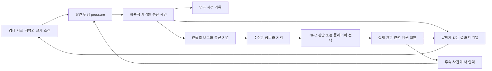

# Crisis & Event Engine v1 안내

세계는 날짜 진행에 따라 경제 결산, NPC의 정책 판단, 압력 평가와 진행 중인 사건을 처리합니다. 실제 역사의 특정 연도에 사건을 강제로 발생시키거나, 플레이어를 돕기 위해 피해를 줄이는 규칙은 없습니다. 기존 Economy v3와 NPC Decision Engine v1의 계산을 사건 시스템이 연결합니다.

## 위험과 사건의 차이

압력은 아직 일어나지 않은 위험입니다. 국경 긴장, 외교위기, 전쟁, 사회불안, 혁명, 쿠데타, 분리주의, 민족·종교 갈등, 금융·재정위기, 불황, 기근, 전염병, 자연재해, 노동불안, 정당성 문제, 군의 불복종을 국가·지역·두 국가 사이에서 보관할 수 있습니다.

압력이 높다는 사실만으로 전쟁이나 혁명이 발생하지 않습니다. 주기적인 평가에서 현재 경제·식량·재정·동원·정책·제도적 취약성과 최근 사건을 함께 읽습니다. 그 조건에서 계산한 연속적인 발생 가능성에 저장된 난수를 사용합니다. 원인이 약한 지역에서 난수만으로 대형위기를 만들지 않습니다. 반대로 이미 쌓인 위험은 단지 시간이 지났다는 이유로 지우지 않습니다.

사건에는 시작일과 종료일, 장소, 관련 국가·인물, 생성 원인과 계기, 심각도, 공개 범위, 실제 사실, 결과, 부모·자식 사건, 확대 단계와 해결 상태를 보관합니다. 같은 원인에서 발생한 후속 사건은 연결됩니다. 현재 사건 상태와 별개로 중요한 시작·대응·피해·전달·종료 기록은 Event Ledger에 남습니다.



## 국경위기와 우발적 전쟁

국경 사건은 외교적 항의, 최후통첩, 부분·전체 동원, 무장 충돌과 전쟁 상태로 이어질 수 있습니다. 모든 위기가 마지막 단계에 도달하지는 않습니다. 협상과 철수, 비용 부담, 대응 선택, 전달된 정보와 현지 행동이 확대 또는 완화에 영향을 줍니다. 한 국가의 중재 요청만으로 상대방의 강경 대응을 취소하지 않습니다. 상호 완화 선택은 협력의 근거가 되며, 일방 철수는 제한적으로 위기를 누그러뜨릴 수 있습니다.

이 구조는 하나의 ‘우발전쟁 확률’ 대신 사건의 연결을 사용합니다. 현지의 제한 행동이 새로운 충돌을 만들고, 그 보고가 지도부 판단을 바꾸고, 강경 대응이 상대방의 위협 인식을 높일 수 있습니다. 전쟁 상태가 생겨도 야전·해전 승패나 전투 사망자는 계산하지 않습니다. 그 부분은 이후 Military Engine의 연결점입니다.

현지 NPC는 실제 위임받은 지역과 `local_action` 권한, 주둔 인력, 전달 정보와 통신 여건 안에서만 제한 행동을 할 수 있습니다. 마음대로 국가 전체를 동원하거나 선전포고하는 별도 우회 경로는 없습니다. 중앙의 결정과 현지의 임시 행동은 서로 다른 기록으로 남습니다.

## 통신과 잘못된 정보

실제 사건 표는 세계의 정답입니다. NPC 판단에는 그 표를 전달하지 않습니다. 사건 관측을 보고서로 만들고, 발송·전달 예정일·실제 수신일을 기록한 뒤, 도착한 보고만 개인의 정보와 기억으로 바꿉니다.

사건 발생일·정보의 관측일·실제 수신일을 구분합니다. 14일 걸려 온 보고는 도착 순간에도 14일 전 정보입니다. 뒤늦게 도착한 오래된 보고나 명령은 수신 이력에는 남지만, 더 최신 정정 정보나 현행 명령을 되돌리지 않습니다. 기억의 시간 경과는 실제로 보고받은 시점부터 계산합니다.

기본 통신 지연은 전근대·초기 산업·산업·고도 산업 profile에서 각각 14·7·3·1일을 출발점으로 사용합니다. 도로·철도·통신 인프라는 지연을 줄이고, 직접 경험한 인물에게는 즉시 전달할 수 있습니다. 이 값은 특정 역사 지역의 실측 통신망 자료가 아닙니다.

보고마다 출처·정확도·확신·신뢰성·과장과 의도적 왜곡, 전달 대상이 있습니다. NPC는 정확도의 정답을 볼 수 없습니다. 정정 보고는 같은 사건에 대한 새 전달이며, 이미 형성된 기억의 해석을 수정할 수 있습니다. 과장된 사망자 보고는 실제 세계의 사망자 수를 늘리지 않습니다.

## 흉작과 기근

흉작은 농업 생산에 대한 충격입니다. 기근은 식량 접근과 공급이 실패한 사회적 결과입니다. 따라서 흉작이 곧 기근은 아닙니다. 지역의 식량 준비, 수송과 수입 여건, 준비자산과 실제 구휼이 결과를 바꿀 수 있습니다.

이번 버전에는 세밀한 식량 가격이나 가계별 소득 모델이 없습니다. 식량안보 지표와 지역의 준비 여력, 교역·교통·정부 대응을 사용합니다. 식량 압력, 사회불안과 후속 사건을 연결하며, 피해는 인구 결산에 근거를 남깁니다. 실제 식량 소비는 계산하지만 농업 재고의 저장기한·부패 손실은 따로 모델링하지 않으므로 장기 비축의 보호 효과가 강할 수 있습니다.

## 재난과 전염병

지역마다 가뭄·홍수·폭풍·지진·화재·극한 추위·극한 더위의 연간 위험과 취약성을 설정합니다. 실제 역사 지역 자료는 아직 없습니다. 재난 피해는 노출된 인구와 도시화, 건축·교통·위생·행정능력·대응 여력의 영향을 받습니다.

전염병은 유입과 확산 압력, 심각도, 밀도·연결성·위생·의료와 대응을 표현합니다. 정확한 감염자 수를 예측하는 역학 모델은 아닙니다. 존재하지 않는 현대 의료기술을 무료로 제공하지 않으며, 기존 의료·위생 수준과 자금을 실제 사용하는 대응이 피해를 줄입니다.

자본과 기반시설 파괴, 생산·교역 차질, 인구 손실은 공통 결과 파이프라인과 경제 충격 인터페이스로 전달합니다. 일회성 파괴와 일정 기간의 생산 차질을 분리합니다. 인구 손실은 월별 출생·사망 결산에 포함되어 인구가 설명 없이 갑자기 바뀌지 않습니다.

## 재정과 사회 위기

재정 사건은 Economy v3의 실제 신용·채무이자·미지급금·준비자산과 지급 실패에서 나옵니다. 없는 상업은행·환율·주식시장을 가짜 숫자로 계산하지 않습니다. 시장 불안은 후속 금융 시스템이 읽을 수 있는 연결점입니다. 재정 협상에는 기존 채무 재조정 구조를 사용하며, 협상 버튼을 누른 것만으로 실제 신용이 회복됐다고 처리하지 않습니다.

식량 부족, 실업·저활용, 세금과 강제 조달, 정부 지급 실패, 동원 부담과 차별·억압 사건은 사회·노동·지역 압력으로 이어질 수 있습니다. 청원·시위·파업·폭동·조세저항·지방봉기의 전조는 서로 구분합니다. 모든 시위가 폭동이나 혁명으로 변하지 않습니다. 완전한 혁명·쿠데타·내전 판정은 구현하지 않았습니다.

## 대응과 정치적 책임

NPC 정부는 사건을 보고받은 뒤 기존 Decision Engine으로 대응을 검토합니다. 사건 종류에 따라 구휼·격리, 협상·양보, 무시, 제한 진압·군 투입 요청, 중재·철수·최후통첩·동원 등의 대안이 있습니다. 실제 권한, 인력과 Economy v3의 정상·비상 조달수단을 확인하고, 자기 정보와 성향·기억으로 판단합니다.

높은 금융 위험 자체가 정치적 선택을 취소하지는 않습니다. 실행에 필요한 사람이나 접근 가능한 재원이 전혀 없으면 집행할 수 없습니다. 위험한 선택을 실행하면 비용과 후속 압력이 실제 세계에 반영됩니다.

플레이어 국가는 중요 사건의 대응을 자동으로 확정하지 않습니다. 선택지·기한·무시했을 때의 결과를 가진 대기 결정을 보관합니다. 기한이 지나면 이미 정의한 미대응 결과를 적용합니다. 그동안 권한을 가진 현지 NPC는 제한된 임시 행동을 할 수 있습니다.

홍수가 일어났다는 이유만으로 통치자의 능력을 낮게 평가하지 않습니다. 자연 발생 사실과 정부 대응 기록은 별개입니다. 자원을 실제 투입한 구휼이나 경고 무시 같은 대응에 대한 근거가 해당 보고를 받은 NPC의 존경·신뢰·원한 등에 영향을 줍니다. 즉시 기록하는 구휼 성과는 자금을 사용해 제공한 대응능력의 추정이며, 아직 최종 피해 예방 성과는 아닙니다. 월별 인구 장부에서 피해 적용을 확인한 뒤 실제 후유증을 별도 기록으로 전달하고 평가를 갱신합니다. ‘예방했을 피해’는 반사실 추정이며 실제 적용 손실과 다른 값으로 표시합니다. 진압 선택 자체에 현대적 도덕 판단을 적용해 행정 실패로 자동 기록하지 않으며, 실제 결과와 알려진 집단의 이해관계로 평가합니다.

## 종료와 재발

진행 중인 사건과 같은 종류의 최근 사건, 해결되지 않은 부모 위기와 재발 간격을 확인합니다. 같은 원인으로 매달 같은 사건을 새로 만들지 않습니다. 재발 간격은 위험의 삭제가 아닙니다. 원인이 남아 있으면 압력도 남고 진행 중인 사건이 후속 단계로 이어질 수 있습니다.

사건 종료는 모든 피해의 원상복구를 뜻하지 않습니다. 파괴된 시설과 사망한 인구, 불신·불만의 잔여 압력, NPC의 기억은 남습니다. 경제 회복과 별도 투자·정책·외교 대응이 회복 경로를 바꿉니다.

## 재현과 저장

사건 시스템은 활성화 시 저장된 게임 RNG에서 출발점을 받습니다. 이후 지역·위험 종류·개별 사건·개인 보고와 판단에 이름 있는 난수 흐름을 사용하고 그 상태를 저장합니다. 무관한 지역에 재난 하나를 추가했다고 다른 모든 사건의 난수 순서가 밀리는 문제를 줄입니다. 기존 경제·NPC의 게임 RNG 규칙은 유지합니다.

사건 기능을 켠 저장은 save schema 5, World schema 4, Crisis state 1을 사용합니다. Economy는 v3, NPC state는 v1을 유지합니다. 기존 저장본에 사건 기능을 조용히 추가하지 않습니다. 명시적으로 켜야 새 규칙이 동작합니다. 진행 중인 사건, 결과 영수증, 전달 중인 보고, 대기 결정과 개별 난수 흐름을 함께 저장합니다.

Auditor는 날짜·지역·인물 참조, 원인 연결의 순환, 피해·자본 파괴의 중복 적용, 종료된 사건의 반복 피해, 잘못된 전달·기억 근거와 기존 기록 삭제 등을 검사합니다. 적용된 결과에는 영수증을 남겨 재실행과 복원 중 중복 피해를 막습니다.

## 검증과 다음 연결

`CRISIS_EVENT_REPORT.md`는 가상 4개국을 30년 운영한 실제 결과, 사건 종류와 확대·완화, 국가별 전쟁 상태 진입, 대응과 손실, 실행시간을 기록합니다. `benchmarks/crisis/`의 CSV와 압축 JSON·시스템 로그는 그 근거입니다. 같은 seed의 전체 반복과 15년 시점 저장·복원을 검사합니다. 장기 중간 복원은 연구용 전체 상태 체크포인트를 사용합니다. 사용자 저장 형식과 실제 SQLite 복원, 연구 실행기와 게임 엔진의 일치는 별도 단기 통합 검사로 확인합니다.

장기 연구 실행은 실제 시스템 계산을 모두 사용하지만 일별 SQLite 쓰기 비용은 제외하고 월말에 상태를 검사합니다. 따라서 보고서의 실행시간은 연구 계산 시간이며 실제 게임의 저장·영구 기록 비용까지 포함한 속도는 아닙니다. 국가·지역·인물 수가 더 커지면 누적 사건과 보고의 저장량, 상태 복사와 검증 비용을 추가로 측정해야 합니다.

최종 제출 보고서는 `CRISIS_EVENT_REPORT.md`입니다. 같은 내용의 `CRISIS_SIMULATION_REPORT.md`도 보관하며, benchmark CLI를 기본 옵션으로 다시 실행하면 이 이름을 사용합니다. 측정 시간에는 실제 시스템 계산, 월말 Auditor와 해당 실행의 압축 로그 쓰기 비용이 포함됩니다.

Military & Logistics Engine은 무장 충돌·전쟁 상태와 당사자, 동원·경제 여건, 통신·현지 행동, 미해결 사건을 읽고 실제 전투·보급 결과를 다시 사건 결과와 보고로 전달할 수 있습니다. 전투를 연결한 뒤에는 같은 병력 손실을 군사·사건·인구 계층에서 두 번 적용하지 않는 통합 검증이 필요합니다.

## 엔진 연결 방법

기존 Economy v3와 NPC v1이 준비된 게임에서 `Engine.enable_crisis(config)`로 명시적으로 활성화합니다. 지역 위험·국경·초기 pressure·플레이어 국가·평가 일정을 설정할 수 있습니다. 지역 위험을 입력하지 않으면 해당 지역의 재난 발생률을 임의로 가정하지 않습니다. 시나리오의 `food_reserve_months` 표시는 실제 식량을 만들어내지 않으며, 기근 판단에는 경제 장부의 식량 재고를 사용합니다.

| 호출 | 의미 |
|---|---|
| `enable_crisis(config)` | 저장 버전과 순서를 검증하고 사건 시스템 활성화 |
| `advance(...)` | 기존 날짜 진행으로 사건·보고·기한·피해도 함께 진행 |
| `pending_decisions(country)` | 보고가 도착한 플레이어 국가의 대기 결정 조회 |
| `respond_to_event(event_id, country, response)` | 선택한 대응의 실제 권한·인력·조달 확인 후 기록 |
| `send_event_report(event_id, actor, ...)` | 명시적 정보 전달·지연·왜곡·정정 연결점 |
| `set_crisis_pressure(category, value, ...)` | 시나리오·후속 시스템의 근거 있는 pressure 입력 |
| `inject_event(...)` | 외부 시스템·검증 시나리오가 실제 발생 사건을 전달하는 신뢰된 연결점 |
| 기존 `save(...)` / `Engine.load(...)` | 사건·RNG·기억·미결 결정까지 동일하게 보존·복원 |

`inject_event`와 정보 전달의 원본은 시나리오 작성자나 후속 시스템용입니다. NPC의 판단 함수에는 이 세계 수정 기능이나 실제 세계 표를 주지 않습니다. 사용자용 CLI·UI·ChatGPT 연결은 이 호출 위에 별도로 붙일 수 있습니다.

장기 실험은 프로젝트 폴더에서 다음과 같이 다시 실행할 수 있습니다.

```powershell
.\.venv\Scripts\python.exe -m worldline.crisis_benchmark --months 360
.\.venv\Scripts\python.exe -m pytest -q
```

구휼 성과에서 실제 결산에 반영된 사망자와 모델이 계산한 ‘대응이 없었을 때의 예상 피해 차이’를 구분합니다. 후자는 계산상 예방 추정치이며 당시 NPC가 직접 관측한 사망 차이라는 뜻이 아닙니다. 최초 대응능력 기록과 월별 결산으로 확인한 후유증 기록도 각각 남습니다.
